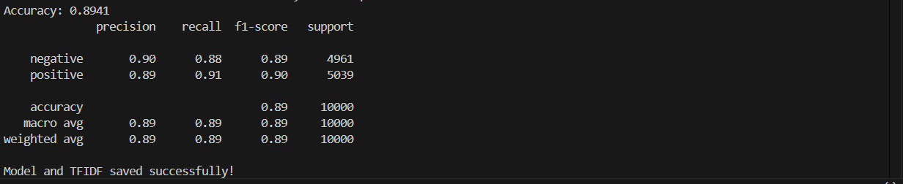

# CinemaSentiment — Real-Time Movie Review Sentiment Analysis

Type a movie title, get an audience verdict: **Positive**, **Mixed** or **Negative**.
The app pulls live user reviews from the [TMDB API](https://developer.themoviedb.org/docs), classifies each one with a TF-IDF + Logistic Regression model trained on IMDb reviews, and aggregates the results.

B.Tech CSE course project (Data Mining / ML), Amity School of Engineering and Technology, Amity University Mumbai, 2024-25. Guide: Dr. Swetta Kukreja. Full report: [`docs/CinemaSentiment_report.pdf`](docs/CinemaSentiment_report.pdf).

## How it works

```
movie title ─► TMDB search ─► TMDB reviews ─► clean text ─► TF-IDF ─► Logistic Regression ─► % positive ─► verdict
```

1. **Train offline** (`src/train_model.py`) on the IMDb 50K dataset (25k positive / 25k negative), 80/20 split.
2. **Predict online** (`src/analyze_movie.py`): fetch reviews for any title, classify each, then:

| % positive | Verdict |
|-----------|---------|
| ≥ 60 | Positive movie |
| 40 – 59 | Mixed movie |
| < 40 | Negative movie |

Thresholds were chosen by hand after inspecting a few well-known films.

**Model:** `TfidfVectorizer(max_features=5000)` + `LogisticRegression(max_iter=200)`.
Preprocessing: lowercase, strip HTML tags and URLs, keep letters only, collapse whitespace. The same function is used in training and inference so the two stay consistent.

## Results

**Test accuracy: 89.4 %** (10,000 held-out reviews, balanced classes). Precision, recall and F1 are 0.89–0.91 for both classes.



Live checks from the report (small samples of TMDB reviews):

| Movie | Positive | Negative | % positive | Verdict | General reception |
|-------|---------:|---------:|-----------:|---------|-------------------|
| Interstellar (2014) | 15 | 3 | 83.3 % | Positive | Widely loved |
| Madame Web (2024) | 2 | 7 | 22.2 % | Negative | Widely criticised |
| Joker: Folie à Deux (2024) | 3 | 7 | 30 % | Negative | Polarising |

## Run it

```bash
git clone https://github.com/<your-username>/cinema-sentiment-analysis
cd cinema-sentiment-analysis
pip install -r requirements.txt
```

1. Download **IMDB Dataset of 50K Movie Reviews** from Kaggle and save it as `IMDB Dataset.csv` in the folder you run training from.
2. Train (creates `sentiment_model.pkl` and `tfidf.pkl`):
   ```bash
   python src/train_model.py
   ```
3. Get a free TMDB API key, then run the analyser **from the same folder as the `.pkl` files**:
   ```bash
   export TMDB_API_KEY=your_key          # Windows PowerShell: $env:TMDB_API_KEY="your_key"
   python src/analyze_movie.py
   ```

## Repo layout

```
src/train_model.py        train + save model and vectorizer
src/analyze_movie.py      live TMDB lookup, prediction, verdict
experiments/              earlier OMDb/IMDb-scraping attempt, replaced by TMDB
docs/                     project report (PDF)
assets/                   training output screenshot
```

## Limitations

- **Binary only.** There is no neutral class; mixed reviews are forced into positive or negative.
- **Domain shift.** The model learned from IMDb reviews written up to 2011; TMDB reviews are newer and use different language and slang.
- **Small live samples.** TMDB returns a limited number of reviews per movie (often 10–20), so a verdict can swing on a few reviews, and the checks above are anecdotal rather than a benchmark.
- **Bag-of-words.** TF-IDF ignores word order, so sarcasm and negation are weak spots.
- **Hand-set thresholds** (60 / 40) are not tuned on labelled movie-level data.

## Future work

DistilBERT fine-tuning, a neutral class, a Streamlit front end, and weighting reviews by length or reviewer credibility.
